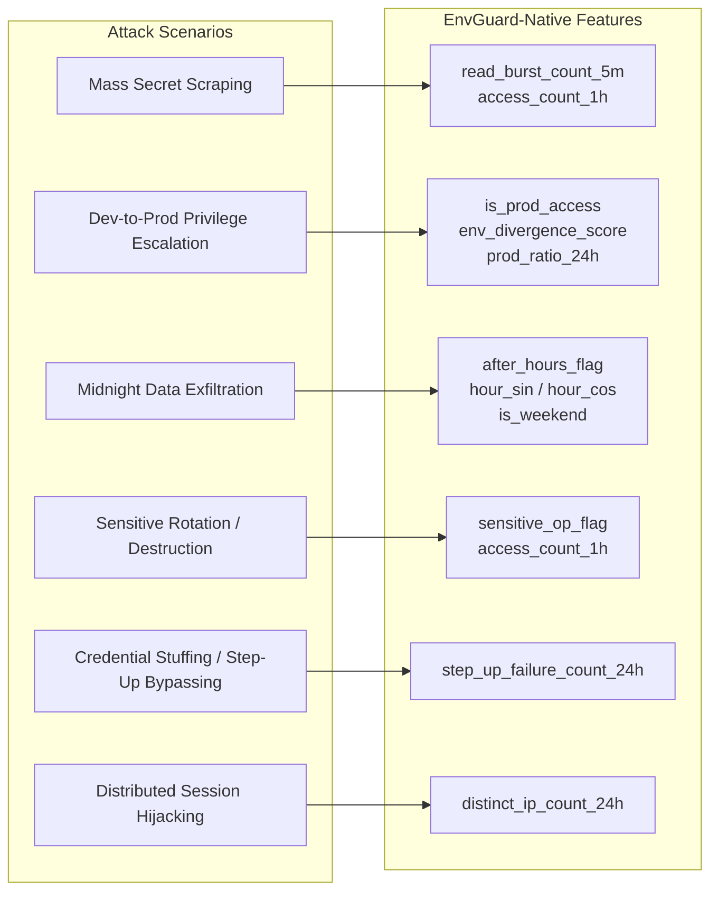

# EnvGuard AI: Native Feature Specification

**Document Reference:** `EG-AI-SPEC-2026-002`  
**Version:** 2.0 (EnvGuard-Native)  
**Date:** November 7, 2026  
**Status:** Approved for Implementation & Inference Engine  

---

## 1. Overview & Objectives

This specification defines the **15 EnvGuard-native behavioral features** designed specifically for real-time anomaly detection in the EnvGuard zero-knowledge secrets management system.

Unlike generic operating system or endpoint detection telemetry (such as the Carnegie Mellon CERT r4.2 benchmark), these features model the operational dynamics of an application-layer secrets vault. The feature set captures:
1. **Environment privilege shifts** (e.g., development users abruptly accessing production secrets).
2. **Access velocity and programmatic exfiltration bursts** (e.g., scripted scraping of multiple secrets).
3. **Temporal anomalies** (after-hours access, weekend activity, circadian cycle divergence).
4. **Operation sensitivity** (secret rotation, deletion, or ephemeral sharing).
5. **Authentication and session anomalies** (failed step-up challenges, distributed IP access).

### Zero-Knowledge Guarantee
In accordance with EnvGuard's zero-knowledge security architecture, all features are extracted exclusively from **permissible operational audit metadata**. The pipeline **never inspects, logs, or processes** decrypted secret values, encryption keys, variable contents, or plaintext payloads.

---

## 2. Required Input Audit Metadata Schema

Every event emitted by the EnvGuard API Gateway must conform to the following metadata structure:

| Field Name | Type | Description | Example |
|---|---|---|---|
| `event_id` | String / UUID | Unique identifier of the audit log record | `"evt_8f1a3b5c9d2e"` |
| `timestamp` | ISO-8601 String / Datetime | UTC timestamp of event invocation | `"2026-11-07T14:22:10Z"` |
| `user_id` | String | Unique developer or service account identifier | `"user_dev_042"` |
| `event_type` | Categorical String | Type of vault operation: `user_login`, `secret_read`, `secret_create`, `secret_update`, `secret_delete`, `secret_rotate`, `secret_share_onetime`, `step_up_challenge` | `"secret_read"` |
| `environment` | Categorical String | Scope of secret: `development`, `staging`, `production` | `"production"` |
| `ip_address` | String | Client remote IP address (IPv4/IPv6) | `"192.168.1.105"` |
| `status` | Categorical String | Operation outcome: `SUCCESS`, `DENIED`, `STEP_UP_REQUIRED`, `STEP_UP_FAILED` | `"SUCCESS"` |

---

## 3. Exhaustive Specification of the 15 EnvGuard-Native Features

| # | Feature Name | Data Type | Range | Historical Window | Calculation Method & Formula | Missing Data / Cold Start Handling |
|---|---|---|---|---|---|---|
| 1 | `access_count_1h` | `float64` | $[0, \infty)$ | Trailing 1 Hour | Count of all vault events by this user within $[t - 1\text{h}, t]$. | Defaults to $1.0$ (current event). |
| 2 | `access_count_24h` | `float64` | $[1, \infty)$ | Trailing 24 Hours | Count of all vault events by this user within $[t - 24\text{h}, t]$. | Defaults to $1.0$ (current event). |
| 3 | `is_prod_access` | `float64` | $\{0.0, 1.0\}$ | Current Event | $1.0$ if `environment == 'production'`, else $0.0$. | Deterministic. |
| 4 | `prod_ratio_24h` | `float64` | $[0.0, 1.0]$ | Trailing 24 Hours | $\frac{\sum_{i \in \text{24h}} \mathbb{I}(\text{env}_i = \text{'production'})}{\text{access\_count\_24h}}$. | Defaults to `is_prod_access`. |
| 5 | `user_prod_history_ratio` | `float64` | $[0.0, 1.0]$ | Trailing 30 Days | Historical baseline ratio of production accesses: $\frac{N_{\text{prod}, 30\text{d}}}{N_{\text{total}, 30\text{d}} + 10^{-5}}$. | New user ($< 5$ total events) defaults to organization baseline: $0.15$. |
| 6 | `env_divergence_score` | `float64` | $[0.0, 1.0]$ | Trailing 30 Days | Absolute divergence: $|\text{is\_prod\_access} - \text{user\_prod\_history\_ratio}|$. | Computed using available or imputed baseline. |
| 7 | `after_hours_flag` | `float64` | $\{0.0, 1.0\}$ | Current Event | $1.0$ if local hour $< 8$ or hour $\ge 18$, else $0.0$. | Extracted from event timestamp. |
| 8 | `hour_sin` | `float64` | $[-1.0, 1.0]$ | Current Event | $\sin\left(\frac{2\pi \cdot \text{hour}}{24}\right)$. | Continuous cyclical representation. |
| 9 | `hour_cos` | `float64` | $[-1.0, 1.0]$ | Current Event | $\cos\left(\frac{2\pi \cdot \text{hour}}{24}\right)$. | Continuous cyclical representation. |
| 10 | `is_weekend` | `float64` | $\{0.0, 1.0\}$ | Current Event | $1.0$ if day of week is Saturday (5) or Sunday (6), else $0.0$. | Extracted from event timestamp. |
| 11 | `sensitive_op_flag` | `float64` | $\{0.0, 1.0\}$ | Current Event | $1.0$ if `event_type` $\in \{\text{'secret\_delete'}, \text{'secret\_rotate'}, \text{'secret\_share\_onetime'}\}$, else $0.0$. | Deterministic. |
| 12 | `read_burst_count_5m` | `float64` | $[0, \infty)$ | Trailing 5 Minutes | Count of `secret_read` events by this user within $[t - 5\text{m}, t]$. | Defaults to $1.0$ if current event is `secret_read`, else $0.0$. |
| 13 | `step_up_failure_count_24h` | `float64` | $[0, \infty)$ | Trailing 24 Hours | Count of events with `status == 'STEP_UP_FAILED'` for this user in $[t - 24\text{h}, t]$. | Defaults to $0.0$. |
| 14 | `distinct_ip_count_24h` | `float64` | $[1, \infty)$ | Trailing 24 Hours | Count of unique IP addresses used by this user in $[t - 24\text{h}, t]$. | Defaults to $1.0$ (current IP). |
| 15 | `user_activity_zscore_24h` | `float64` | $(-\infty, \infty)$ | Trailing 30 Days | $\frac{\text{access\_count\_24h} - \mu_{\text{daily}, u}}{\sigma_{\text{daily}, u} + 1.0}$, where $\mu_{\text{daily}, u}$ and $\sigma_{\text{daily}, u}$ are user's historical 30-day mean and std. | New user with no history defaults to $0.0$. |

---

## 4. Threat Scenario Mapping Matrix

The 15 features map directly to the threat vectors EnvGuard is designed to intercept:

---

## 5. Streaming and Real-Time Calculation Architecture

To enable synchronous request evaluation, feature calculation operates in two tiers:
1. **Instantaneous Features (Zero State Required):**  
   `is_prod_access`, `after_hours_flag`, `hour_sin`, `hour_cos`, `is_weekend`, `sensitive_op_flag`. Computed directly from the incoming HTTP request metadata in $< 0.1$ ms.
2. **Sliding-Window Features (State Cache):**  
   `access_count_1h`, `access_count_24h`, `prod_ratio_24h`, `read_burst_count_5m`, `step_up_failure_count_24h`, `distinct_ip_count_24h`. Maintained via a sliding window of recent user events (e.g. in-memory deque or Redis sorted set `ZREMRANGEBYSCORE`).
3. **Longitudinal User Profiles (Periodic Background Cache):**  
   `user_prod_history_ratio`, `user_activity_zscore_24h`. Computed once per day from database audit tables and cached per user.

This dual-tier architecture guarantees $< 5$ ms total feature extraction latency per request.

