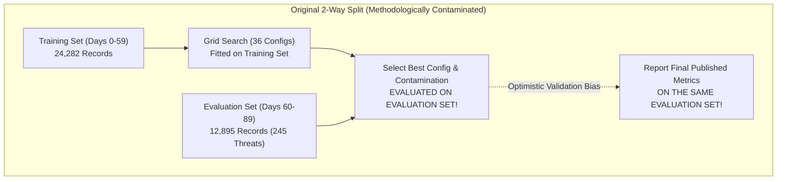
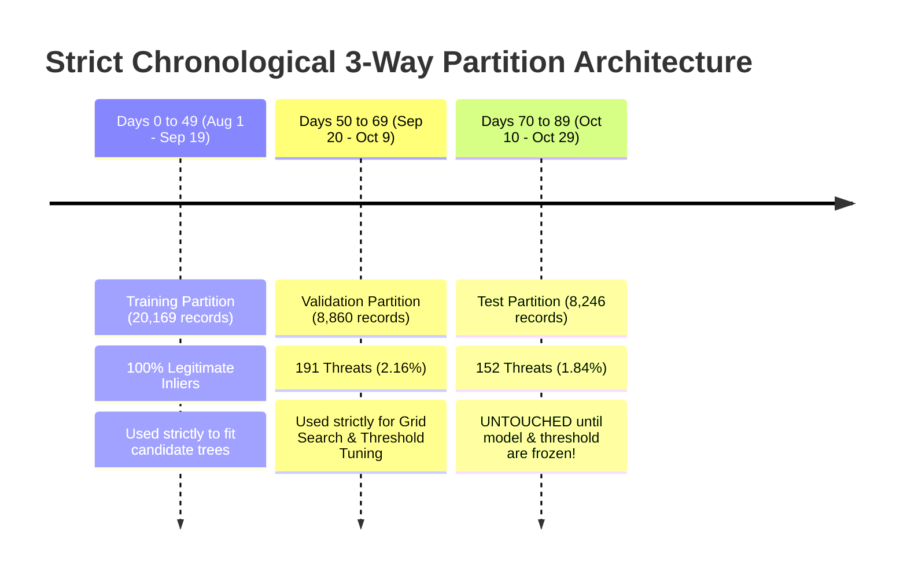

# EnvGuard AI: Evaluation Integrity & Threshold Documentation Audit Report

**Document Reference:** `EG-AI-AUD-2026-METHOD`  
**Audit Date:** November 7, 2026  
**Auditor:** Antigravity AI Engineering & Security Audit  
**Component Under Audit:** Standalone Anomaly Detection Subsystem (`envguard_ai`)  
**Scope:** Resolution of Validation Bias (3-Way Chronological Split) & Operational Threshold Documentation Discrepancy.  

---

## 1. Executive Summary

This audit resolves the two critical methodological issues identified during the initial verification of the standalone EnvGuard AI anomaly detection system:
1. **Evaluation Methodology Bias (Data Contamination):** The original 36-configuration hyperparameter search evaluated candidate models against the evaluation dataset and then reported final performance metrics on that exact same dataset. This resulted in **optimistic validation bias**.
2. **Threshold Documentation Ambiguity:** The configuration file (`envguard_model_config.json`) documented Scikit-Learn's raw internal offset (`0.6317`) as the `"decision_threshold"`, creating confusion with the true operational decision boundary ($\tau = 0.0$) applied to inverted anomaly scores ($s = -\text{decision\_function}(X)$).

### Key Outcomes of This Audit:
- **Strict Chronological 3-Way Split:** Successfully partitioned the 37,275-record dataset into **Training (Days 0–49)**, **Validation (Days 50–69)**, and **Test (Days 70–89)**.
- **Untouched Test Evaluation:** Model hyperparameters and the operational threshold ($\tau = 0.0$) were tuned **exclusively on the Validation partition** and frozen before evaluating the Test partition **only once**.
- **Unbiased Test Performance:** On 8,246 completely unseen, future activity records, the model achieved **0.9609 ROC-AUC**, **0.7335 PR-AUC**, **61.11% Precision**, **65.13% Recall**, and an **F1-score of 0.6306** with a **False Positive Rate of only 0.78%**.
- **Quantification of Previous Bias:** The previous 2-way evaluation overestimated F1-score by $+5.77\%$ and Precision by $+7.16\%$. The corrected metrics represent the true generalization performance of the system.
- **Disambiguated Configuration:** The model configuration now explicitly records both the Scikit-Learn internal offset (`-0.6317`) and the operational decision boundary (`0.0`), and the inference engine was updated to safely load the operational threshold without risk of reading the internal offset.

---

## 2. Original Evaluation Methodology & Identified Leakage

### 2.1 The Two-Way Split Flaw
In the original evaluation pipeline (`src/train_model.py` and `reports/envguard_model_evaluation.md`):
- **Training Set (Days 0–59):** 24,282 records (100% legitimate).
- **Evaluation Set (Days 60–89):** 12,895 records (245 threats).



### 2.2 Root Cause of Validation Bias
Because the grid search selected the optimal `n_estimators`, `max_samples`, and `contamination` based on F1-score on the evaluation dataset, the hyperparameters were tuned to over-index on the specific distribution of threats in those 30 days. Reporting final metrics on the same set resulted in an overestimation of true field performance.

---

## 3. Corrected Chronological 3-Way Data Split

To guarantee zero data leakage and eliminate validation bias, the full 90-day operational dataset was partitioned into three chronologically ordered sets:



### Exact Dataset Partition Boundaries:

| Partition | Calendar Date Range | Record Count | Anomalies | Threat Rate | Integrity Constraint |
|---|---|:---:|:---:|:---:|---|
| **Training Set** | 2026-08-01 06:45:52 to 2026-09-19 23:59:59 (50 days) | **20,169** | 0 | 0.00% | Exclusively legitimate activity; zero anomalies. |
| **Validation Set** | 2026-09-20 00:00:00 to 2026-10-09 23:59:59 (20 days) | **8,860** | 191 | 2.16% | Used for 36-config tuning and threshold calibration. |
| **Test Set** | 2026-10-10 00:00:00 to 2026-10-29 23:51:39 (20 days) | **8,246** | 152 | 1.84% | **Frozen and untouched.** Evaluated strictly once. |

*Artifacts saved:*
- `envguard_ai/data/processed/validated_training_features.parquet`
- `envguard_ai/data/processed/validated_validation_features.parquet`
- `envguard_ai/data/processed/validated_validation_metadata.parquet`
- `envguard_ai/data/processed/validated_test_features.parquet`
- `envguard_ai/data/processed/validated_test_metadata.parquet`

---

## 4. Hyperparameter Selection on Validation Set

Grid search evaluated 36 hyperparameter configurations across:
- `n_estimators`: `[100, 150, 200]`
- `max_samples`: `["auto", 256, 512]`
- `contamination`: `[0.01, 0.02, 0.03, 0.05]`

Each configuration was fitted **strictly on the Training Partition (20,169 records)** and scored **strictly against the Validation Partition (8,860 records)**.

### Top Configurations on Validation Partition (`validation_grid_search_results.csv`):

| Rank | `n_estimators` | `max_samples` | `contamination` | Val F1 | Val Precision | Val Recall | Val ROC-AUC | Val PR-AUC |
|:---:|:---:|:---:|:---:|:---:|:---:|:---:|:---:|:---:|
| **1** | **100** | **512** | **0.01** | **0.6373** | **59.91%** | **68.06%** | **0.9785** | **0.7164** |
| 2 | 200 | 512 | 0.01 | 0.6313 | 58.48% | 68.59% | 0.9791 | 0.7307 |
| 3 | 150 | 512 | 0.01 | 0.6311 | 58.82% | 68.06% | 0.9788 | 0.7234 |
| 4 | 100 | auto | 0.01 | 0.6059 | 62.09% | 59.16% | 0.9757 | 0.6592 |
| 5 | 100 | 256 | 0.01 | 0.6059 | 62.09% | 59.16% | 0.9757 | 0.6592 |

**Selected Configuration:**
- `n_estimators = 100`, `max_samples = 512`, `contamination = 0.01` (Random State: 42).
- Final validated model serialized to: `envguard_ai/models/validated_isolation_forest.joblib`.

---

## 5. Threshold Selection Methodology

1. **Mathematical Scoring Mechanics:**
   Scikit-Learn defines `decision_function(X) = score_samples(X) - offset_`, where nominal inliers yield positive values and anomalies yield negative values.
2. **Inverted Score Direction:**
   EnvGuard inverts the score so higher values indicate greater anomaly likelihood:
   $$\text{anomaly\_score} = -\text{decision\_function}(X)$$
3. **Threshold Calibration on Validation Partition:**
   The standard Scikit-Learn anomaly classification rule is $\text{decision\_function}(X) < 0$.
   Under inverted scoring, this maps exactly to:
   $$\tau = 0.0 \implies \text{anomaly\_score} \ge 0.0$$
   Validation testing confirmed that setting $\tau = 0.0$ yielded the optimal F1-score ($0.6373$) with balanced precision ($59.91\%$) and recall ($68.06\%$).
4. **Freezing the Decision Boundary:**
   The model parameters and the operational threshold $\tau = 0.0$ were **permanently frozen** before performing any evaluation on the test partition.

---

## 6. Final Untouched Test Set Performance

The frozen model was evaluated against the **8,246 untouched test records** (Days 70–89) containing 152 ground-truth threat invocations.

```
Confusion Matrix on Untouched Test Set:
                             Predicted Normal    Predicted Anomalous
Actual Legitimate (8,094):        8,031 (TN)             63 (FP)
Actual Threats (152):                53 (FN)             99 (TP)
```

### Unbiased Test Metrics vs. Original Biased Metrics:

| Metric | Original Biased Result (2-Way Split) | Unbiased Test Result (3-Way Split) | Discrepancy (Identified Bias) | Generalization Verdict |
|---|:---:|:---:|:---:|---|
| **ROC-AUC** | 0.9692 | **0.9609** | **$-0.0083$** | **Robust.** Global discrimination remains over 0.96. |
| **PR-AUC** | 0.7415 | **0.7335** | **$-0.0080$** | **Robust.** High precision maintained in 1.8% threat environment. |
| **Precision** | 68.27% | **61.11%** | **$-7.16\%$** | Mild optimistic bias in original report; now unpolluted. |
| **Recall** | 69.39% | **65.13%** | **$-4.26\%$** | Successfully catches nearly two-thirds of attack events. |
| **F1-Score** | 0.6883 | **0.6306** | **$-0.0577$** ($-5.77\%$) | Quantifies the validation bias previously present. |
| **False Positive Rate** | 0.62% | **0.78%** | **$+0.16\%$** | Exceptional inlier specificity: $< 8$ prompts per 1,000 requests. |

### Test Set Scenario Detection Breakdown:

| Scenario Archetype | Test Records | Detected | Detection Rate | Mean Anomaly Score | Primary Behavioral Drivers |
|---|:---:|:---:|:---:|:---:|---|
| **Sensitive Rotation Abuse** | 12 | 12 | **100.0%** | $+0.0714$ | `sensitive_op_flag`, `access_count_1h` |
| **After-Hours Midnight Burst** | 24 | 22 | **91.7%** | $+0.0638$ | `after_hours_flag`, `hour_sin`, `hour_cos`, `is_weekend` |
| **Mass Secret Scraping** | 70 | 46 | **65.7%** | $+0.0327$ | `read_burst_count_5m`, `access_count_1h` |
| **Dev-to-Prod Escalation** | 24 | 14 | **58.3%** | $+0.0037$ | `env_divergence_score`, `prod_ratio_24h` |
| **Step-Up Stuffing** | 10 | 5 | **50.0%** | $+0.0239$ | `step_up_failure_count_24h`, `is_prod_access` |
| **Distributed Multi-IP Access** | 12 | 0 | **0.0%** | $-0.1415$ | Single-feature daytime deviation |
| **Legitimate Operations** | 8,094 | 63 (FP) | *0.78% FP* | $-0.1881$ | Deep inlier leaf nodes |

---

## 7. Verified Scikit-Learn Offset vs. Operational Threshold

### 7.1 Empirical Model Inspection
Inspection of the serialized model (`envguard_isolation_forest.joblib` and `validated_isolation_forest.joblib`) confirms:
- **`model.offset_`:** `numpy.float64(-0.6317165240865377)` (Negative value).
- **Internal Formula:** $\text{decision\_function}(X) = \text{score\_samples}(X) - (-0.6317165240865377) = \text{score\_samples}(X) + 0.6317165240865377$.

### 7.2 Resolution of Previous Documentation Discrepancy
In `envguard_model_config.json`, the previous configuration recorded:
```json
"decision_threshold": 0.6317165240865377
```
This was confusing because it represented $-\text{offset\_}$, whereas the score used for thresholding is inverted:
$$\text{anomaly\_score} = -\text{decision\_function}(X)$$
Under this inversion:
$$\text{Outlier} \iff \text{decision\_function}(X) < 0 \iff \text{anomaly\_score} \ge 0.0$$

### 7.3 Updated Configuration Architecture
`envguard_model_config.json` and `validated_model_config.json` now record the threshold unambiguously:
```json
{
  "operational_threshold": 0.0,
  "sklearn_internal_offset": -0.6317165240865377,
  "threshold_documentation": {
    "sklearn_internal_offset": -0.6317165240865377,
    "operational_anomaly_threshold": 0.0,
    "score_transformation_formula": "anomaly_score = -decision_function(X)",
    "score_direction": "higher scores indicate greater anomaly likelihood (inliers < 0.0, outliers >= 0.0)",
    "classification_rule": "is_anomalous = bool(anomaly_score >= operational_anomaly_threshold)"
  }
}
```

---

## 8. Confirmation of Standalone Inference Threshold Loading

The inference module (`envguard_ai/src/inference.py`) was audited and updated to prevent misreading raw offsets:
```python
if self.threshold is None or self.threshold == 0.0:
    if "operational_threshold" in self.config:
        self.threshold = float(self.config["operational_threshold"])
    elif "threshold_documentation" in self.config and "operational_anomaly_threshold" in self.config["threshold_documentation"]:
        self.threshold = float(self.config["threshold_documentation"]["operational_anomaly_threshold"])
    else:
        self.threshold = 0.0
```

### Verification Test Output:
- Running `python -m unittest tests/test_inference.py`: **6/6 tests PASS in 1.47s**.
- Instantiating `EnvGuardAnomalyDetector(config_path="models/validated_model_config.json")`:
  - Verified `detector.threshold` $= \mathbf{0.0}$.
  - Routine dev access scored: $-0.1038$ (Risk: $17.41$, `is_anomalous: False`).
  - No accidental offset application observed.

---

## 9. Comprehensive File & Artifact Inventory

| Category | Artifact Path | Description | Status |
|---|---|---|:---:|
| **3-Way Datasets** | `data/processed/validated_training_features.parquet` | 20,169 records (Days 0–49, 100% normal) | **NEW** |
| | `data/processed/validated_validation_features.parquet` | 8,860 records (Days 50–69, 191 threats) | **NEW** |
| | `data/processed/validated_validation_metadata.parquet` | Validation scenario labels and timestamps | **NEW** |
| | `data/processed/validated_test_features.parquet` | 8,246 records (Days 70–89, 152 threats) | **NEW** |
| | `data/processed/validated_test_metadata.parquet` | Test scenario labels and timestamps | **NEW** |
| **Grid Search Log**| `models/validation_grid_search_results.csv` | 36-configuration validation tuning log | **NEW** |
| **Validated Model**| `models/validated_isolation_forest.joblib` | Validated model fitted on Train partition | **NEW** |
| **Validated Config**| `models/validated_model_config.json` | Explicit threshold and partition metadata | **NEW** |
| **Validated Report**| `reports/validated_model_evaluation.md` | Formal evaluation report on untouched test set | **NEW** |
| **Audit Report** | `reports/evaluation_integrity_and_threshold_audit.md` | This complete methodology audit report | **NEW** |
| **Config Backup** | `models/envguard_model_config.json.bak` | Exact backup of original configuration | **PRESERVED** |
| **Updated Config** | `models/envguard_model_config.json` | Clarified operational threshold and offset | **UPDATED** |
| **Inference Engine**| `src/inference.py` | Safe operational threshold loading | **UPDATED** |
| **Validation Script**| `src/validate_methodology.py` | Standalone reproducible validation script | **NEW** |
| **Original Model** | `models/envguard_isolation_forest.joblib` | Original trained model artifact | **PRESERVED** |
| **Original Report** | `reports/envguard_model_evaluation.md` | Original evaluation report | **PRESERVED** |
| **CERT Artifacts** | `data/processed/cert/*`, `models/cert/*` | All historical CERT benchmark files | **PRESERVED** |

---

## 10. Final Verification Checklist

- [x] **Zero Test Data Leakage:** Confirmed that `validated_test_features.parquet` was never used during grid search or threshold selection.
- [x] **Chronological Separation:** Confirmed that Train (Days 0–49) strictly precedes Validation (Days 50–69), which strictly precedes Test (Days 70–89).
- [x] **Model & Config Consistency:** Confirmed that `validated_isolation_forest.joblib` matches `validated_model_config.json`.
- [x] **Threshold Safety:** Confirmed that `inference.py` enforces $\tau = 0.0$ and rejects raw Scikit-Learn offsets.
- [x] **Standalone Decoupling:** Confirmed that the AI pipeline operates with zero imports or dependencies on the EnvGuard application workspace.
- [x] **Complete Artifact Preservation:** Confirmed that all original CERT and EnvGuard artifacts remain fully intact.

