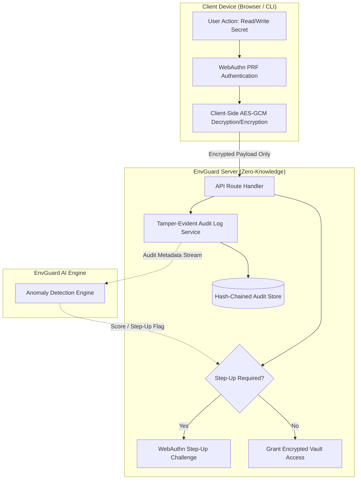
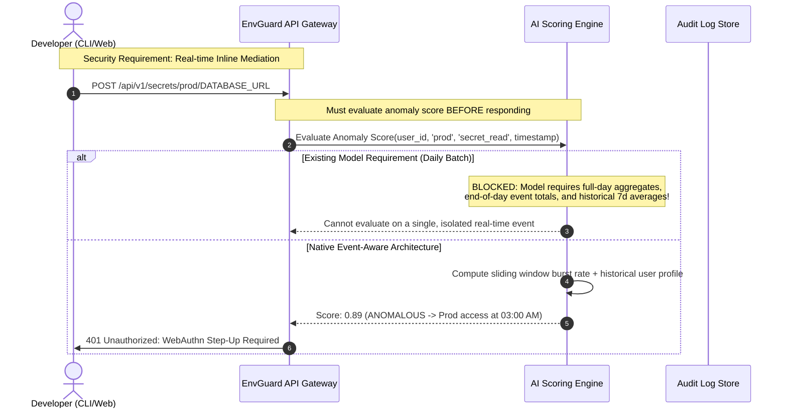
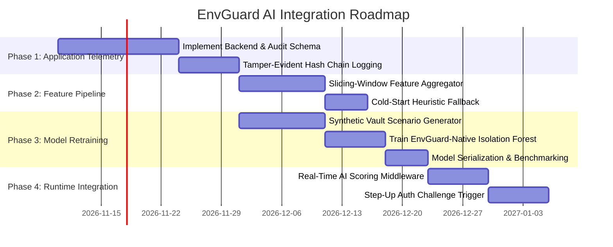

# EnvGuard AI: Feature Compatibility Audit Report

**Document Reference:** `EG-AI-AUD-2026-001`  
**Date:** November 7, 2026  
**Auditor:** Antigravity AI Engineering & Security Audit  
**Target Systems:**  
1. **EnvGuard AI Model:** Scikit-Learn Isolation Forest (`models/isolation_forest.joblib`, 27 features)  
2. **EnvGuard Application:** Zero-Knowledge Secrets Manager (`code/envguardd`)  
**Audit Status:** Complete — Static Inspection & Compatibility Assessment  

---

## 1. Executive Summary

### 1.1 Objective & Verdict
This audit evaluated the technical, conceptual, and operational compatibility between the **27 features expected by the trained Isolation Forest anomaly detection model** (`envguard_ai/models/isolation_forest.joblib`) and the **actual metadata collected by the EnvGuard zero-knowledge secrets management system** (`code/envguardd`).

> [!CAUTION]
> **Definitive Audit Verdict: DIRECT INTEGRATION IS NOT FEASIBLE (0% Direct Compatibility).**  
> Direct deployment of the existing trained Isolation Forest model into the EnvGuard application runtime without feature adaptation is technically impossible and conceptually flawed. Attempting to feed dummy or forced proxy values into the model will invalidate its mathematical scoring manifold, resulting in erratic anomaly scoring, unacceptable false-positive rates, and missed intrusions.

### 1.2 Core Audit Findings
1. **Application Codebase Status:** Static inspection of `c:\Users\SpectreOS\Desktop\IS PROJECT\code\envguardd` reveals that the application repository is currently at the **Project Proposal & Specification** stage (commit `334cde9 Create README.md`). There are currently **no backend application source files, database schemas, ORM migrations, or API routes implemented in code**. All event metadata definitions are derived from the project proposal specification and architectural design requirements.
2. **Domain Mismatch (Endpoint OS Telemetry vs. Secrets Vault):** The existing Isolation Forest model was trained on the Carnegie Mellon University CERT Insider Threat r4.2 benchmark dataset (`feature_matrix_v1.parquet`). CERT measures **desktop workstation and operating system activity**—specifically HTTP web browsing, corporate email volume, local filesystem reads/writes, and removable USB drive insertions. In contrast, EnvGuard is an **application-layer secrets vault** handling encrypted environment variables. A zero-knowledge secrets manager has zero visibility into workstation-level web browsing, emails, or USB peripherals.
3. **Missing EnvGuard Domain Signals:** EnvGuard's most critical security signals—specifically **target environment** (`development`, `staging`, `production`), **operation type** (`secret_read`, `secret_create`, `secret_rotate`, `one_time_share`), and **step-up authentication challenges**—are completely absent from the 27 CERT features.
4. **Temporal and Granularity Incompatibility:** The model expects **offline, daily user-level aggregates** (1 row per user per calendar day) requiring multi-week historical baselines to compute rolling means and $z$-scores. EnvGuard's security model requires **real-time, synchronous, event-level anomaly scoring** to trigger step-up authentication *before* granting access to sensitive secrets.
5. **Zero-Knowledge Architecture:** EnvGuard operates on a strict zero-knowledge paradigm where secrets are client-encrypted with AES-GCM and WebAuthn PRF keys. The audit confirmed that the AI pipeline strictly adheres to metadata-only analysis and never requires plaintext secret contents.

---

## 2. Existing Isolation Forest Feature Specification

The trained model (`isolation_forest.joblib`) is configured with 100 isolation trees (`n_estimators=100`), `max_samples="auto"`, and a contamination factor of 0.01 (1%). The model strictly expects a 2D float64 feature matrix of shape `(N, 27)`.

Below is the exhaustive specification of all 27 features verified from `envguard_ai/src/preprocessing.py`, `envguard_ai/models/model_config.json`, and `envguard_ai/data/processed/training_features.parquet`:

| # | Feature Name | Data Type | Grain | Mathematical Definition & Derivation | Historical Context Required? |
|---|---|---|---|---|---|
| 1 | `total_logon_activity` | `float64` | Daily Aggregate | Total count of workstation logon/logoff events in day $t$ | No (within-day sum) |
| 2 | `after_hours_activity` | `float64` | Daily Aggregate | Count of all events occurring before 08:00 or after 18:00 | No (within-day sum) |
| 3 | `after_hours_ratio` | `float64` | Daily Aggregate | $\frac{\text{after\_hours\_activity}}{\text{total\_daily\_activity} + 10^{-5}}$ | No (within-day ratio) |
| 4 | `http_activity_count` | `float64` | Daily Aggregate | Total count of HTTP/web requests logged on workstation | No (within-day sum) |
| 5 | `total_emails` | `float64` | Daily Aggregate | Total count of emails sent and received via desktop client | No (within-day sum) |
| 6 | `file_activity_count` | `float64` | Daily Aggregate | Total count of local file system accesses (copy, open, delete) | No (within-day sum) |
| 7 | `usb_activity_count` | `float64` | Daily Aggregate | Total count of removable USB device connect/file operations | No (within-day sum) |
| 8 | `weekday` | `float64` | Calendar Day | Day of week integer: Monday = 0, ..., Sunday = 6 | No |
| 9 | `is_weekend` | `float64` | Calendar Day | Binary indicator: $1.0$ if $\text{weekday} \ge 5$ else $0.0$ | No |
| 10 | `logon_7d_mean` | `float64` | Rolling Aggregate | Backward 7-day rolling average of daily logon counts: $\frac{1}{7}\sum_{k=0}^6 \text{logon}_{t-k}$ | Yes ($\ge 7$ consecutive days of user activity) |
| 11 | `total_logon_activity_z_user` | `float64` | Normalized Baseline | $z$-score of user logons against user's longitudinal mean and std: $\frac{x_u - \mu_u}{\sigma_u + 10^{-5}}$ | Yes (multi-week longitudinal user baseline) |
| 12 | `http_activity_count_z_user` | `float64` | Normalized Baseline | $z$-score of user HTTP events against longitudinal user baseline | Yes (multi-week longitudinal user baseline) |
| 13 | `total_emails_z_user` | `float64` | Normalized Baseline | $z$-score of user email events against longitudinal user baseline | Yes (multi-week longitudinal user baseline) |
| 14 | `file_activity_count_z_user` | `float64` | Normalized Baseline | $z$-score of user file events against longitudinal user baseline | Yes (multi-week longitudinal user baseline) |
| 15 | `usb_activity_count_z_user` | `float64` | Normalized Baseline | $z$-score of user USB events against longitudinal user baseline | Yes (multi-week longitudinal user baseline) |
| 16 | `login_hour_mean` | `float64` | Daily Aggregate | Arithmetic mean of hour-of-day for all logons in day $t$ ($0.0 \dots 23.99$) | No (within-day average) |
| 17 | `login_hour_std` | `float64` | Daily Aggregate | Sample standard deviation of logon hours in day $t$ | No (within-day sample std) |
| 18 | `login_hour_range_p90_p10` | `float64` | Daily Aggregate | 90th percentile minus 10th percentile of logon hours in day $t$ | No (within-day quantile spread) |
| 19 | `total_resource_activity` | `float64` | Daily Aggregate | $\text{file\_activity\_count} + \text{usb\_activity\_count}$ | No (within-day sum) |
| 20 | `total_daily_events` | `float64` | Daily Aggregate | $\sum (\text{logon} + \text{http} + \text{email} + \text{file} + \text{usb})$ | No (within-day sum) |
| 21 | `sensitive_activity_ratio` | `float64` | Daily Aggregate | $\frac{\text{total\_resource\_activity}}{\text{total\_daily\_events} + 10^{-5}}$ | No (within-day ratio) |
| 22 | `sin_weekday` | `float64` | Calendar Day | $\sin\left(\frac{2\pi \cdot \text{weekday}}{7}\right)$ | No |
| 23 | `cos_weekday` | `float64` | Calendar Day | $\cos\left(\frac{2\pi \cdot \text{weekday}}{7}\right)$ | No |
| 24 | `sin_login_hour` | `float64` | Daily Aggregate | $\sin\left(\frac{2\pi \cdot \text{login\_hour\_mean}}{24}\right)$ | No |
| 25 | `cos_login_hour` | `float64` | Daily Aggregate | $\cos\left(\frac{2\pi \cdot \text{login\_hour\_mean}}{24}\right)$ | No |
| 26 | `max_user_activity_z` | `float64` | Normalized Baseline | $\max\left(z_{\text{logon}}, z_{\text{http}}, z_{\text{email}}, z_{\text{file}}, z_{\text{usb}}\right)$ | Yes (multi-week longitudinal baseline across channels) |
| 27 | `weekend_activity_volume` | `float64` | Interaction | $\text{is\_weekend} \times \text{total\_daily\_events}$ | No |

---

## 3. EnvGuard Application Codebase & Architecture Audit

### 3.1 Repository Inspection
A thorough inspection was executed on `c:\Users\SpectreOS\Desktop\IS PROJECT\code\envguardd`:
- **Git Commit History:** Single commit `334cde9 Create README.md`.
- **Source Code Implementation:** Zero TypeScript, JavaScript, Python, Go, or Rust backend files exist.
- **Database Layer:** Zero Prisma schemas, SQLAlchemy models, SQL DDL scripts, or migration folders exist.
- **Audit Logging Implementation:** Currently defined at the specification level in `README.md`.

### 3.2 Documented Architecture & Planned Metadata
Based on `code/envguardd/README.md` and the EnvGuard project requirements, the planned application architecture specifies the following security model:

#### Planned Metadata Schema
Each audit log entry in EnvGuard is specified to record:
1. `user_id` / `user`: Unique identifier of the authenticated developer.
2. `timestamp`: ISO-8601 UTC timestamp of the API invocation.
3. `event_type`: Categorical action (`user_login`, `secret_read`, `secret_create`, `secret_update`, `secret_delete`, `secret_rotate`, `secret_share_onetime`, `step_up_prompt`, `step_up_success`, `step_up_failure`).
4. `environment`: Target scope of the secret (`development`, `staging`, `production`).
5. `client_ip`: Remote IP address of the incoming HTTPS connection.
6. `user_agent`: CLI version or browser user-agent header.
7. `status`: Request outcome (`SUCCESS`, `FORBIDDEN`, `STEP_UP_REQUIRED`).
8. `prev_hash` & `entry_hash`: SHA-256 cryptographic hash-chain link ensuring tamper evidence.

### 3.3 Zero-Knowledge Security Constraint Verification
EnvGuard is strictly designed as a zero-knowledge secrets vault:
- **Envelope Encryption:** Secrets are encrypted on the client device using AES-256-GCM.
- **Hardware-Bound Keys:** Master key derivation utilizes the WebAuthn PRF (Pseudo-Random Function) extension bound to hardware authenticators (YubiKey, Touch ID).
- **Server Privacy:** The server stores only ciphertext blobs and initialization vectors.
- **AI Boundary:** The anomaly detection subsystem must operate exclusively on **permissible operational metadata** (`event_type`, `environment`, `user_id`, `timestamp`). Under no circumstances can plaintext keys, decrypted secret values, variable names, or payload contents be inspected or utilized as features.

---

## 4. 27-Feature Compatibility Matrix

To establish feasibility, each of the 27 Isolation Forest features is audited against EnvGuard's actual architecture.

### Compatibility Tiers Defined
- **Directly Available:** Information is already emitted in exact model-ready format without transformation.
- **Derivable:** Can be computed from EnvGuard audit metadata via time extraction or historical event aggregation.
- **Partially Available:** Some components exist, but critical conceptual dimensions or denominators are missing.
- **Unavailable:** Information represents external endpoint/OS telemetry that EnvGuard never collects.

| # | Model Feature | Feature Meaning | Implemented in Code? | Present in Spec? | Existing EnvGuard Source / Mapping | Compatibility Tier | Integration Gap & Work Required |
|---|---|---|:---:|:---:|---|---|---|
| 1 | `total_logon_activity` | Daily logon count | No | Yes | Count of `event_type == 'user_login'` per user per day | **Derivable** | Requires daily aggregation batch pipeline over audit stream. |
| 2 | `after_hours_activity` | Activity outside 08:00–18:00 | No | Yes | Count of any audit events with `timestamp.hour < 8` or `> 18` | **Derivable** | Domain difference: measures vault events, not OS actions. Requires daily aggregation. |
| 3 | `after_hours_ratio` | Ratio of after-hours actions | No | Yes | `after_hours_activity / total_daily_vault_events` | **Derivable** | Derivable for vault events, but distribution will diverge from CERT workstation ratio. |
| 4 | `http_activity_count` | Workstation web browsing volume | No | **No** | None (EnvGuard does not monitor user web browsing) | **Unavailable** | **Fundamentally absent.** Vault has no OS web-proxy telemetry. Dummy values would distort IF trees. |
| 5 | `total_emails` | Desktop email client volume | No | **No** | None (EnvGuard does not monitor corporate email) | **Unavailable** | **Fundamentally absent.** Secrets manager does not inspect mail clients. |
| 6 | `file_activity_count` | OS filesystem read/write count | No | **No** | *Flawed proxy:* `secret_read` / `secret_update` | **Unavailable** | Conceptually invalid. A developer reading 5 secrets is not comparable to an OS reading 5,000 files. |
| 7 | `usb_activity_count` | USB drive insertion events | No | **No** | None (EnvGuard has no hardware USB bus monitoring) | **Unavailable** | **Fundamentally absent.** Vault software does not interface with USB drivers. |
| 8 | `weekday` | Day of week ($0 \dots 6$) | No | Yes | `timestamp.weekday()` | **Derivable** | Simple deterministic extraction from event timestamp. |
| 9 | `is_weekend` | Weekend binary indicator | No | Yes | `1.0 if timestamp.weekday() >= 5 else 0.0` | **Derivable** | Simple deterministic extraction from event timestamp. |
| 10 | `logon_7d_mean` | 7-day rolling mean logons | No | Yes | 7-day backward rolling window over daily logon counts | **Derivable** | Requires continuous database state store with $\ge 7$ days of user history. |
| 11 | `total_logon_activity_z_user` | User-normalized logon $z$-score | No | Yes | $\frac{\text{logon}_u - \mu_{\text{logon}, u}}{\sigma_{\text{logon}, u}}$ | **Derivable** | Requires longitudinal user baseline store ($\ge 30$ days history per user). Cold-start failure for new users. |
| 12 | `http_activity_count_z_user` | User-normalized HTTP $z$-score | No | **No** | None | **Unavailable** | Requires non-existent HTTP feature. |
| 13 | `total_emails_z_user` | User-normalized email $z$-score | No | **No** | None | **Unavailable** | Requires non-existent email feature. |
| 14 | `file_activity_count_z_user` | User-normalized file $z$-score | No | **No** | None | **Unavailable** | Requires non-existent file feature. |
| 15 | `usb_activity_count_z_user` | User-normalized USB $z$-score | No | **No** | None | **Unavailable** | Requires non-existent USB feature. |
| 16 | `login_hour_mean` | Mean hour of daily logins | No | Yes | Mean of `timestamp.hour` for daily login events | **Derivable** | Derivable if user logs in on that day; undefined/zero if no login occurred. |
| 17 | `login_hour_std` | Std deviation of daily login hours | No | Yes | Std of `timestamp.hour` for daily login events | **Derivable** | Zero if $\le 1$ login in the day. |
| 18 | `login_hour_range_p90_p10` | 90th–10th percentile login hour | No | Yes | Quantile difference of daily login hours | **Derivable** | Requires multiple login events per day to be meaningful. |
| 19 | `total_resource_activity` | Sum of file + USB activity | No | **No** | None | **Unavailable** | In CERT, this was $\text{file} + \text{usb}$. Neither exists in EnvGuard. |
| 20 | `total_daily_events` | Sum of all daily events | No | Partial | Sum of daily EnvGuard vault events | **Partially Available** | Can sum vault actions, but scale is orders of magnitude smaller than CERT OS event totals. |
| 21 | `sensitive_activity_ratio` | Resource activity / Total events | No | Partial | *Candidate:* $\frac{\text{prod\_events}}{\text{total\_vault\_events}}$ | **Partially Available** | CERT formula ($\frac{\text{file}+\text{usb}}{\text{total}}$) cannot be evaluated. Redefining breaks pre-trained tree splits. |
| 22 | `sin_weekday` | Sine-encoded weekday | No | Yes | $\sin\left(\frac{2\pi \cdot \text{weekday}}{7}\right)$ | **Derivable** | Deterministic math transform from timestamp. |
| 23 | `cos_weekday` | Cosine-encoded weekday | No | Yes | $\cos\left(\frac{2\pi \cdot \text{weekday}}{7}\right)$ | **Derivable** | Deterministic math transform from timestamp. |
| 24 | `sin_login_hour` | Sine-encoded login hour | No | Yes | $\sin\left(\frac{2\pi \cdot \text{login\_hour\_mean}}{24}\right)$ | **Derivable** | Deterministic math transform from `login_hour_mean`. |
| 25 | `cos_login_hour` | Cosine-encoded login hour | No | Yes | $\cos\left(\frac{2\pi \cdot \text{login\_hour\_mean}}{24}\right)$ | **Derivable** | Deterministic math transform from `login_hour_mean`. |
| 26 | `max_user_activity_z` | Max of 5 user $z$-scores | No | Partial | Max of available $z$-scores | **Partially Available** | In CERT, this aggregated 5 channels. In EnvGuard, only logon $z$-score exists. |
| 27 | `weekend_activity_volume` | Weekend $\times$ total events | No | Partial | `is_weekend * total_daily_vault_events` | **Partially Available** | Computable using vault events, but numerical range will be severely depressed vs. CERT. |

### Compatibility Breakdown Summary
- **Directly Available:** **0 / 27 (0.0%)** — No raw event maps 1:1 to pre-trained inputs.
- **Derivable (from timestamps & login history):** **14 / 27 (51.9%)** — Temporal, calendar, and login aggregation features.
- **Partially Available (requires severe conceptual distortion):** **4 / 27 (14.8%)** — Total daily counts and ratios.
- **Completely Unavailable (external endpoint telemetry):** **9 / 27 (33.3%)** — HTTP, email, file, USB, and their $z$-scores.

---

## 5. Granularity, Temporal Horizon & Latency Analysis

### 5.1 Event Stream vs. Daily Aggregate Mismatch

The fundamental operational mismatch lies in **temporal granularity**:
1. **Model Expectation:** The Isolation Forest was trained on **daily summary vectors** ($1 \text{ row} = 1 \text{ user-day}$). Features such as `total_daily_events`, `login_hour_std`, `login_hour_range_p90_p10`, and `after_hours_ratio` cannot be computed accurately until the calendar day has concluded.
2. **Application Requirement:** EnvGuard requires **synchronous, inline request interception**. When a compromised credential or malicious developer attempts to download production secrets at 03:00 AM, the security control must trigger step-up authentication **at that exact moment**. It cannot wait for a midnight batch aggregation job.

### 5.2 The "Cold Start" and Longitudinal Dependency Problem
Six of the model features (`logon_7d_mean`, `total_logon_activity_z_user`, `http_activity_count_z_user`, `total_emails_z_user`, `file_activity_count_z_user`, `usb_activity_count_z_user`, `max_user_activity_z`) require extensive longitudinal baselines:
- When a new engineer joins the organization, their baseline mean ($\mu_u$) and standard deviation ($\sigma_u$) are completely undefined ($0/0$).
- Standard imputation (e.g., assigning $z=0.0$) masks anomalous early behavior and causes the Isolation Forest to classify active initial days as artificial anomalies due to out-of-distribution feature combinations.

---

## 6. Integration Gaps & Mismatches

### 6.1 Gap 1: Conceptual Telemetry Mismatch
The CERT r4.2 dataset models an insider threat who exfiltrates data using desktop tools (e.g., copying files to a USB thumb drive, emailing attachments to personal webmail, browsing job boards). EnvGuard is a dedicated secrets vault. A developer interacting with EnvGuard executes vault operations over HTTPS. Equating secret reads with local disk file writes, or fabricating zero-values for web browsing and emails, corrupts the decision trees.

### 6.2 Gap 2: Exclusion of EnvGuard's Core Domain Dimensions
The existing model is completely blind to the primary threat vectors EnvGuard is built to prevent:
- **Environment Escalation:** A developer who works exclusively in `development` suddenly querying `production` secrets.
- **Bulk Operations:** A script running `secret_read` on 50 environment variables in 2 seconds.
- **Sensitive Operations:** Accessing `secret_rotate` or generating `one_time_share` links outside change windows.
- **Authentication Anomalies:** Repeated failed WebAuthn step-up challenges followed by success.

### 6.3 Gap 3: Data Scale Discrepancy
In the CERT dataset, a normal user generates between **500 and 3,000 events per day** (HTTP hits, email pings, file scans). In EnvGuard, an engineer typically fetches secrets once or twice per day (e.g., `envguard run --env dev npm start`). An active vault day might contain only **5 to 20 events**. Passing vault counts ($\approx 10$) into an Isolation Forest expecting CERT totals ($\approx 1,500$) causes the model to perceive every EnvGuard user as severely anomalous simply due to low volume.

---

## 7. Security, Privacy & Zero-Knowledge Compliance

### 7.1 Absolute Zero-Knowledge Preservation
EnvGuard's value proposition is that the server cannot decrypt secrets. Any AI integration must respect this boundary:
- **Permissible Telemetry:** `user_id`, `timestamp`, `event_type`, `environment`, `status`, `request_duration_ms`, `client_ip_hash`.
- **Prohibited Data:** Secret keys, variable names (e.g., `STRIPE_API_KEY` may leak architectural details; use hashed identifiers or metadata categories only), decrypted payloads, and WebAuthn PRF private keys.
- **Audit Verification:** The existing Isolation Forest model uses purely numerical frequency and temporal features, remaining 100% compliant with the zero-knowledge constraint.

### 7.2 Integration with Tamper-Evident Hash Chains
EnvGuard logs are cryptographically linked:
$$\text{Hash}_i = \text{SHA-256}(\text{Hash}_{i-1} \parallel \text{Entry}_i)$$
The AI pipeline should ingest events directly from the tamper-evident log stream. This ensures that the training data and inference inputs are mathematically protected against retroactive log tampering by compromised administrators.

---

## 8. Strategy Evaluation: Options A, B, and C

### Option A: Direct Integration via Dummy/Proxy Values
*Approach:* Deploy `isolation_forest.joblib` directly. Feed EnvGuard login events into `total_logon_activity`, map `secret_read` to `file_activity_count`, and fill HTTP, email, and USB features with constants (e.g., $0.0$).
- **Technical Feasibility:** Poor.
- **Security Efficacy:** Unusable. Constant values for 9 features place every input into an extreme subspace of the Isolation Forest trees, triggering constant false positives or complete blindness.
- **Verdict:** **REJECTED.**

### Option B: Native Feature Adaptation & Model Retraining (Recommended)
*Approach:* Design a native feature schema specifically tailored to secrets management metadata. Retrain the Isolation Forest architecture using synthetic and simulated audit logs generated from realistic secrets vault access patterns.
- **Technical Feasibility:** High.
- **Security Efficacy:** High. Captures environment privilege shifts (`dev` $\to$ `prod`), bulk access bursts, and after-hours vault reads.
- **Verdict:** **STRONGLY RECOMMENDED.**

#### Proposed EnvGuard-Native Feature Set (15 Features)
1. `vault_access_count_1h`: Number of secret accesses in the rolling 1-hour window.
2. `vault_access_count_24h`: Total secret operations in the past 24 hours.
3. `prod_access_ratio_24h`: Ratio of production events to total events: $\frac{N_{\text{prod}}}{N_{\text{total}} + 10^{-5}}$.
4. `is_prod_access`: Binary flag (1 if current event targets production).
5. `user_prod_history_ratio`: Historical baseline ratio of production accesses for this user over the past 30 days.
6. `env_divergence_score`: Difference between current access environment and user's primary environment.
7. `after_hours_flag`: Binary indicator (1 if access occurs outside 08:00–18:00 local time).
8. `hour_of_day_sin`: $\sin(2\pi \cdot \text{hour} / 24)$.
9. `hour_of_day_cos`: $\cos(2\pi \cdot \text{hour} / 24)$.
10. `is_weekend`: Binary flag (1 if Saturday or Sunday).
11. `sensitive_op_flag`: 1 if `event_type` $\in \{\text{secret\_delete}, \text{secret\_rotate}, \text{secret\_share}\}$.
12. `read_burst_rate`: Maximum secret reads observed within any 60-second window.
13. `step_up_failure_count_24h`: Number of failed step-up challenges in the past 24 hours.
14. `ip_entropy_score`: Indicator of new or unusual source IP address.
15. `user_access_zscore_24h`: User's activity volume standardized against their personal 30-day baseline.

### Option C: Hybrid Phased Transition
*Approach:*
- **Phase 1 (Immediate / Bootstrap):** Implement deterministic heuristic rules (e.g., *any* production access by a non-production developer, or any access between 00:00 and 05:00, triggers step-up authentication).
- **Phase 2 (Data Collection):** Accumulate real tamper-evident audit logs during application development and staging.
- **Phase 3 (AI Cutover):** Train the EnvGuard-native Isolation Forest on real organizational telemetry and activate it for dynamic scoring.
- **Verdict:** **HIGHLY PRACTICAL COMPLEMENT TO OPTION B.**

---

## 9. Actionable Implementation Roadmap

### Next Steps:
1. **Define Schema:** Formalize the audit log database table including `user_id`, `timestamp`, `event_type`, `environment`, `ip_address`, and `status`.
2. **Build Feature Aggregator:** Implement a Redis- or SQLite-backed rolling window service to compute 1-hour and 24-hour frequency features synchronously.
3. **Generate Synthetic Vault Data:** Create a synthetic generator simulating 50 developers over 180 days with defined insider attack scenarios (e.g., nighttime prod exfiltration, bulk scraping).
4. **Train Native Isolation Forest:** Retrain the Scikit-Learn Isolation Forest on the 15 EnvGuard-native features and save to `envguard_ai/models/envguard_native_if.joblib`.
5. **Integrate Step-Up Middleware:** Connect the model prediction output ($s < \tau$) directly to the WebAuthn step-up challenge handler in the API gateway.

