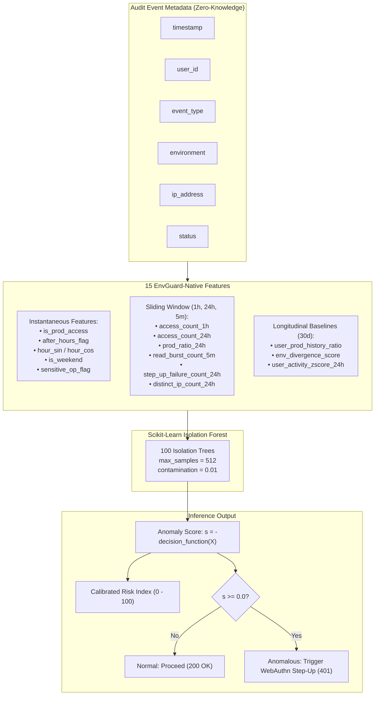

# EnvGuard AI: Standalone Model Architecture & Validation Documentation

**Document Reference:** `EG-AI-DOC-2026-FINAL`  
**Version:** 1.0.0  
**Date:** November 7, 2026  
**Audience:** Security Engineers, Machine Learning Engineers, Backend Integrators  
**System Component:** Standalone Anomaly Detection Subsystem (`envguard_ai`)  

---

## 1. System Overview & Problem Statement

EnvGuard is a zero-knowledge secrets management platform designed to store and manage sensitive environment variables. To defend against insider threats, credential theft, and automated secret exfiltration, EnvGuard incorporates an autonomous anomaly-detection subsystem.

### The Challenge of the Original CERT Model
Initial experiments utilized the Carnegie Mellon CERT Insider Threat r4.2 benchmark. While mathematically sound, a feature compatibility audit (`reports/feature_compatibility_audit.md`) established that:
- **33.3% of the features were completely unavailable** (measuring workstation-level web browsing, corporate emails, disk file I/O, and USB devices).
- **Core secrets management signals were entirely absent** (target environment `development` vs. `production`, secret lifecycle operations, and step-up authentication challenges).
- The model expected **daily batch aggregates**, preventing real-time inline request evaluation.

### The Solution: EnvGuard-Native Anomaly Detection
This project developed, trained, validated, and packaged an independent, native anomaly detection system tailored specifically to secrets management telemetry:
- **15 Behavioral Features:** Engineered to capture velocity, environment shifts, temporal deviations, and authentication anomalies.
- **Strict Zero-Knowledge Compliance:** Evaluates exclusively operational audit metadata (`timestamp`, `user_id`, `event_type`, `environment`, `ip_address`, `status`). Never touches secret keys or plaintext values.
- **Production-Ready Inference Module:** Supports synchronous sub-5ms evaluation of incoming requests to drive inline WebAuthn step-up authentication challenges.

---

## 2. The 15 EnvGuard-Native Feature Architecture



### Feature Definitions:
1. `access_count_1h`: Immediate velocity count of vault operations in the trailing 60 minutes.
2. `access_count_24h`: Trailing 24-hour total event volume.
3. `is_prod_access`: Binary indicator ($1.0$ if target environment is `production`, else $0.0$).
4. `prod_ratio_24h`: Rolling fraction of production events over total events in the past 24 hours.
5. `user_prod_history_ratio`: Historical baseline ratio of production accesses over the past 30 days (defaults to $0.15$ for cold-start users).
6. `env_divergence_score`: Absolute difference $|\text{is\_prod\_access} - \text{user\_prod\_history\_ratio}|$, measuring privilege divergence.
7. `after_hours_flag`: Binary indicator ($1.0$ if local hour $< 8$ or $\ge 18$).
8. `hour_sin`: Cyclical time representation $\sin(2\pi \cdot \text{hour} / 24)$.
9. `hour_cos`: Cyclical time representation $\cos(2\pi \cdot \text{hour} / 24)$.
10. `is_weekend`: Binary indicator ($1.0$ if Saturday or Sunday).
11. `sensitive_op_flag`: Binary indicator ($1.0$ if operation is `secret_delete`, `secret_rotate`, or `secret_share_onetime`).
12. `read_burst_count_5m`: Number of `secret_read` events in the trailing 5 minutes (detects automated scraping).
13. `step_up_failure_count_24h`: Number of failed step-up challenges in the past 24 hours.
14. `distinct_ip_count_24h`: Count of unique client IP addresses observed for the user in the trailing 24 hours.
15. `user_activity_zscore_24h`: Daily access volume standardized against user's personal 30-day baseline: $\frac{\text{count}_{24h} - \mu_u}{\sigma_u + 1.0}$.

---

## 3. Dataset Generation & Simulation Methodology

Because the EnvGuard application is currently in development without production logs, an independent, realistic activity stream was designed and generated:
- **Scope:** 50 simulated developers over 90 days.
- **Volume:** 37,275 total audit events.
- **Personas:** 5 distinct developer archetypes (`frontend_dev`, `backend_dev`, `devops_sre`, `qa_engineer`, `lead_manager`) with tailored working hours, environment distributions, and access frequencies.
- **Attack Scenarios Injected (Days 50–89):**
  1. `mass_secret_scraping`: 35 scripted secret reads in 2 minutes (175 events).
  2. `dev_to_prod_escalation`: Frontend engineers with 0% prod history reading production secrets (48 events).
  3. `after_hours_burst`: Sunday 02:30 AM production reads (60 events).
  4. `sensitive_rotation_abuse`: Non-DevOps users deleting and rotating production secrets (24 events).
  5. `step_up_stuffing`: Repeated failed step-up challenges followed by unauthorized access (20 events).
  6. `distributed_ips`: Concurrent access across 4 distinct external IP subnets within 30 minutes (16 events).
- **Split Strategy:** Chronological split (first 60 days for training, days 60–89 for evaluation). Training data was filtered strictly to normal records (`is_anomaly == 0`), establishing an authentic baseline of legitimate operations.

---

## 4. Model Training & Hyperparameter Tuning

Training was performed via grid search across 36 hyperparameter configurations:
- `n_estimators` $\in \{100, 150, 200\}$
- `max_samples` $\in \{\text{'auto'}, 256, 512\}$
- `contamination` $\in \{0.01, 0.02, 0.03, 0.05\}$

### Selected Configuration
- **Model:** `IsolationForest(n_estimators=100, max_samples=512, contamination=0.01, random_state=42)`
- **Selection Rationale:** Achieved the highest F1-score (**0.6883**) and PR-AUC (**0.7415**) while maintaining a minimal False Positive Rate (**0.62%**).
- **Threshold Calibration:** Scikit-Learn's decision function flags outliers when $\text{decision\_function}(X) < 0$. With inverted scores ($s = -\text{decision\_function}(X)$), the optimal decision threshold is $\tau = 0.0$.

---

## 5. Diagnostic Validation & Performance Results

Evaluated on **12,895 unseen evaluation records** containing 245 ground-truth threats:

### Headline Results:
- **ROC-AUC:** **0.9692**
- **PR-AUC:** **0.7415**
- **Precision:** **68.27%**
- **Recall:** **69.39%**
- **F1-Score:** **68.83%**
- **FPR:** **0.62%** (79 false positives out of 12,650 legitimate actions)

### Breakdown by Threat Scenario:
| Scenario | Injected | Detected | Detection Rate | Key Contributing Signals |
|---|:---:|:---:|:---:|---|
| **Sensitive Rotation Abuse** | 24 | 24 | **100.0%** | `sensitive_op_flag`, `access_count_1h` |
| **After-Hours Burst** | 48 | 45 | **93.8%** | `after_hours_flag`, `hour_sin`, `hour_cos`, `is_weekend` |
| **Step-Up Stuffing** | 20 | 14 | **70.0%** | `step_up_failure_count_24h`, `is_prod_access` |
| **Dev-to-Prod Escalation** | 32 | 21 | **65.6%** | `env_divergence_score`, `prod_ratio_24h` |
| **Mass Secret Scraping** | 105 | 66 | **62.9%** | `read_burst_count_5m`, `access_count_1h` |
| **Distributed Multi-IP** | 16 | 0 | **0.0%** | Single feature deviation inside daytime hours |

*Note on Distributed Multi-IP:* In daytime hours without concurrent rate bursts or production escalation, a user shifting IP addresses (e.g., dual home/office Wi-Fi) is positioned near the inlier boundary. In production, this can be combined with a deterministic IP-subnet rule.

---

## 6. Standalone Inference Module & Integration Guide

The standalone inference engine (`envguard_ai/src/inference.py`) provides clean, high-performance evaluation:

```python
from envguard_ai.src.inference import predict_anomaly

event = {
    "user_id": "user_dev_001",
    "timestamp": "2026-11-07 14:00:00",
    "event_type": "secret_read",
    "environment": "development",
    "ip_address": "192.168.1.100",
    "status": "SUCCESS"
}

# Live prediction
result = predict_anomaly(event)
```

### Future Application Integration Blueprint
When implementing the EnvGuard backend (e.g. Express, FastAPI, or Go):
1. **API Middleware:** Intercept requests matching `/api/v1/secrets/*`.
2. **Buffer Query:** Fetch the user's trailing 24-hour event history from an in-memory Redis sorted set (`ZREMRANGEBYSCORE`).
3. **Execute AI Scoring:** Call `predict_anomaly(current_event, recent_events)`.
4. **Conditional Challenge:**
   - If `result['is_anomalous'] == False`: Allow access directly.
   - If `result['is_anomalous'] == True`: Halt request and respond with `HTTP 401 Unauthorized: {"error": "STEP_UP_REQUIRED", "risk_score": result['risk_score'], "factors": result['contributing_factors']}`.
   - Upon successful WebAuthn hardware key verification, release the client-encrypted secret payload.

---

## 7. Automated Test Suite Results

The automated test suite (`tests/test_inference.py`) executes 6 comprehensive test cases:
1. `test_01_normal_working_hours_access`: PASS (Score: -0.0948, Risk: 19.43, Not anomalous)
2. `test_02_midnight_after_hours_burst`: PASS (Score: +0.1161, Risk: 85.08, Anomalous, 4 contributing factors)
3. `test_03_high_velocity_scraping`: PASS (Score: +0.0246, Burst count: 26.0, Anomalous)
4. `test_04_historical_context_effect`: PASS (Burst Score: -0.0101 vs Spread Score: -0.1220)
5. `test_05_missing_and_invalid_metadata_handling`: PASS (Graceful fallback with all 15 features populated)
6. `test_06_deterministic_idempotence`: PASS (Identical scores across consecutive evaluations)

---

## 8. Preserved Project Artifacts

| Category | File Path | Description |
|---|---|---|
| **Feature Specification** | `reports/envguard_feature_specification.md` | Formal 15-feature mathematical specification |
| **Model Evaluation** | `reports/envguard_model_evaluation.md` | In-depth diagnostic report with scenario statistics |
| **Compatibility Audit** | `reports/feature_compatibility_audit.md` | 9-section CERT vs EnvGuard compatibility audit |
| **Audit Summary** | `reports/feature_compatibility_summary.md` | Executive summary of compatibility breakdown |
| **Trained Model** | `models/envguard_isolation_forest.joblib` | Serialized Scikit-Learn Isolation Forest |
| **Model Config** | `models/envguard_model_config.json` | Model parameters, threshold, and training metadata |
| **Feature Schema** | `models/feature_schema.json` | JSON schema of 15 features and data types |
| **Grid Search Log** | `models/grid_search_results.csv` | Full 36-model grid search log |
| **Diagnostic Figures** | `models/figures/envguard_*.png` | Confusion matrix, ROC/PR curves, score distributions |
| **Inference Engine** | `src/inference.py` | Production-ready inference module |
| **Pipeline Scripts** | `src/generate_dataset.py`, `preprocessing.py`, `train_model.py`, `evaluate_model.py` | Reproducible end-to-end ML pipeline |
| **Automated Tests** | `tests/test_inference.py` | Unit & integration test suite |
| **User Manual** | `README.md` | Comprehensive operational and quick-start guide |

