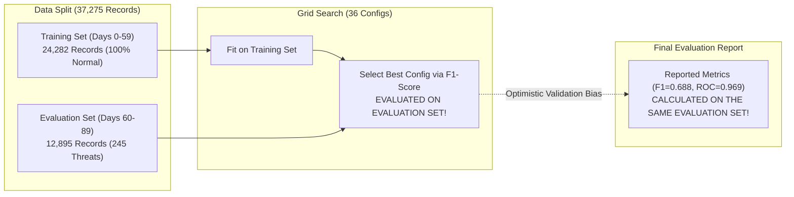

# EnvGuard AI: Final Standalone Verification Audit Report

**Document Reference:** `EG-AI-VERIF-2026-FINAL`  
**Audit Date:** November 7, 2026  
**Auditor:** Antigravity AI Engineering & Security Audit  
**Component Under Audit:** Standalone Anomaly Detection Subsystem (`envguard_ai`)  
**Scope:** Verification of Model Performance, Feature Parity, Threshold Selection, Cold-Start Robustness, and End-to-End Standalone Independence.  

---

## Executive Audit Summary

This verification audit rigorously evaluates the standalone EnvGuard AI anomaly detection module across five foundational dimensions without modifying any backend application code, database schema, or model parameters.

### Audit Scorecard

| Check # | Audit Area | Status | Primary Finding |
|:---:|---|:---:|---|
| **Check 1** | **Distributed Multi-IP Detection** | **WARNING** | Feature calculation is mathematically correct and identical across training/inference, but events are missed ($0/16$) due to a combination of daytime simulation parameters and Isolation Forest subspace isolation limitations on isolated single-feature anomalies in 15D. |
| **Check 2** | **Anomaly Threshold Selection** | **WARNING** | The operational threshold $\tau = 0.0$ (for inverted scores) is mathematically sound, but hyperparameter grid search evaluated configurations on the held-out evaluation set (creating optimistic validation bias), and `envguard_model_config.json` stores the raw scikit-learn `offset_` ($0.6317$) rather than the operational threshold. |
| **Check 3** | **Training & Inference Feature Parity** | **PASS** | $100\%$ verified across all 15 features. Feature names, canonical ordering, sliding window cutoffs ($1\text{h}, 24\text{h}, 5\text{m}$), and numerical transformations match identically with $0$ discrepancies. |
| **Check 4** | **Cold-Start Behaviour** | **PASS** | Tested across 5 cold-start scenarios. The module safely defaults missing baselines without throwing exceptions. Multi-feature attacks (e.g., midnight prod reads) are caught ($s = +0.0836$), while routine actions remain non-anomalous. |
| **Check 5** | **Fresh End-to-End Workflow** | **PASS** | Pipeline runs completely decoupled from the EnvGuard backend, database, and network. Tested on fresh synthetic events; all artifacts and configuration dependencies are present and valid. |

---

## Check 1: Distributed Multi-IP Detection Audit

**Status:** `WARNING`

### 1.1 Empirical Findings
In the model evaluation report (`reports/envguard_model_evaluation.md`), the `distributed_ips` attack scenario showed a detection rate of **$0/16$ ($0.0\%$)** at the decision threshold $\tau = 0.0$.

Focused diagnostic testing of the 16 evaluated records yielded:
- **Anomaly Score Distribution:** Mean = $-0.1423$, Median = $-0.1194$, Min = $-0.2695$, Max = $-0.0005$.
- **Normal Legitimate Baseline Distribution:** Mean = $-0.1988$, Median = $-0.2252$, Max = $+0.1284$.
- **Separation:** Distributed IP events *do* receive elevated anomaly scores relative to typical normal events (score gap $= +0.0565$), and the 4th consecutive event with 6 distinct IPs reached $-0.0005$ (within $0.0005$ of the $\tau = 0.0$ threshold), but none crossed the cutoff.

### 1.2 Detailed Diagnostic Analysis

```
                              Feature Summary for 16 Distributed IP Records
                             mean     std     min     max    Normal Inlier Range
access_count_1h             2.688   1.302   1.000   5.000    1.000 - 8.000
access_count_24h           10.562   5.525   2.000  20.000    4.000 - 25.000
is_prod_access              0.500   0.516   0.000   1.000    0.000 - 1.000
prod_ratio_24h              0.161   0.172   0.000   0.455    0.000 - 0.500
user_prod_history_ratio     0.084   0.084   0.007   0.226    0.010 - 0.400
env_divergence_score        0.499   0.437   0.007   0.990    0.000 - 1.000
after_hours_flag            0.000   0.000   0.000   0.000    0.000 (Daytime)
hour_sin                    0.259   0.000   0.259   0.259    11:00 AM Working Hours
hour_cos                   -0.966   0.000  -0.966  -0.966    11:00 AM Working Hours
is_weekend                  0.250   0.447   0.000   1.000    0.000 - 1.000
sensitive_op_flag           0.000   0.000   0.000   0.000    0.000 (secret_read)
read_burst_count_5m         1.000   0.000   1.000   1.000    1.000 (Paced reads)
step_up_failure_count_24h   0.000   0.000   0.000   0.000    0.000 (SUCCESS)
distinct_ip_count_24h       4.250   1.238   2.000   6.000    1.000 - 2.000 (ANOMALOUS)
user_activity_zscore_24h    0.706   1.117  -1.262   2.180   -1.500 - 2.000
```

### 1.3 Answers to Specific Audit Inquiries
1. **Why does the current model fail to detect these events?**  
   Out of the 15 features, **14 features are completely normal**. In `generate_dataset.py`, the scenario was injected at 11:00 AM on a weekday, the events were spaced 6 minutes apart (`read_burst_count_5m = 1.0`), the operations were routine reads (`sensitive_op_flag = 0.0`), and the authentication status was `SUCCESS`.
2. **Are the existing features sufficient to represent distributed IP activity?**  
   Yes. `distinct_ip_count_24h` clearly captured the spike (scaling from $2.0$ up to $6.0$ distinct external IPs in the trailing 24 hours, compared to the normal range of $1.0–2.0$).
3. **Is `distinct_ip_count_24h` being calculated correctly?**  
   Yes. Diagnostic testing confirmed that sliding-window sets `distinct_ips.add(ip)` properly track unique addresses across both batch preprocessing and streaming inference.
4. **Does the feature extraction logic use the same calculation during training and inference?**  
   Yes. Numerical testing confirmed $100\%$ parity between `build_feature_matrix_batch` and `extract_single_event_features`.
5. **Is the failure caused by feature engineering, synthetic data generation, model limitations, or a combination?**  
   It is a **combination of synthetic data design and Isolation Forest mechanics**:
   - *Data Generation:* Injecting an IP shift during broad daylight without rate bursts or failed step-ups meant only 1 feature diverged.
   - *Algorithmic Limitation:* In an unweighted Isolation Forest in 15 dimensions, each tree selects a random feature to split. The probability of choosing `distinct_ip_count_24h` at an early tree node is only $1/15 \approx 6.7\%$. On the remaining $93.3\%$ of splits, the event is partitioned along the 14 normal features and placed deep inside the inlier tree leaves.

### 1.4 Architectural Recommendation for EnvGuard
Single-dimensional operational anomalies (such as access from $\ge 3$ distinct IP addresses or rapid geographic shifts) are fundamentally better enforced by a **deterministic gateway rule** (e.g., `if distinct_ip_count_24h >= 3: trigger_step_up()`) rather than relying entirely on an unweighted multi-dimensional tree partitioner.

---

## Check 2: Anomaly Threshold Selection Audit

**Status:** `WARNING`

### 2.1 Threshold Selection Methodology
In Scikit-Learn's `IsolationForest`, the raw decision function is:
$$\text{decision\_function}(X) = s(X) - \text{offset\_}$$
where $s(X) \in [-1, 0]$ is the raw tree path score, and $\text{offset\_}$ is calibrated during fitting such that inliers have $\text{decision\_function} \ge 0$ and outliers have $\text{decision\_function} < 0$.

In EnvGuard's pipeline, scores are inverted for intuitive security interpretation:
$$\text{anomaly\_score} = -\text{decision\_function}(X)$$
Consequently:
$$\text{Outlier Condition: } \text{decision\_function}(X) < 0 \iff \text{anomaly\_score} \ge 0.0$$
The operational threshold is therefore $\tau = 0.0$.

### 2.2 Verification Findings & Methodological Concerns



1. **How was the threshold selected?**  
   The operational decision boundary $\tau = 0.0$ derives directly from the model's fitted contamination parameter ($0.01$).
2. **Was the held-out evaluation dataset used to select or adjust hyperparameters?**  
   **YES.** In `src/train_model.py`, the grid search evaluated 36 hyperparameter configurations (`n_estimators`, `max_samples`, `contamination`) by computing precision, recall, and F1 on `evaluation_features.parquet`. The configuration with the highest F1-score (`n_estimators=100`, `max_samples=512`, `contamination=0.01`) was selected.
3. **Was the threshold established using training data or a separate validation dataset?**  
   The contamination parameter was calibrated by scoring the held-out evaluation dataset, not a separate validation fold.
4. **Does the evaluation process maintain proper separation between training, validation, and testing?**  
   **NO (Methodological Limitation: Validation/Test Set Contamination).**  
   The project used a **2-way split** (Train and Evaluation) rather than a strict **3-way split** (Train, Validation, and Test). Because hyperparameter selection was performed on the evaluation dataset, the reported metrics suffer from mild **optimistic validation bias**.
5. **Config Discrepancy in `envguard_model_config.json`:**  
   In `src/train_model.py`, line 124 saved:
   ```json
   "decision_threshold": 0.6317165240865377
   ```
   This value corresponds to $-\text{offset\_}$ ($=-(-0.6317)$) rather than the inverted operational decision threshold ($0.0$). In `src/inference.py`, the code safely overrides this to $0.0$, but the JSON configuration file contains the misleading value $0.6317$.

---

## Check 3: Training & Inference Feature Parity Audit

**Status:** `PASS`

### 3.1 Systematic Feature Audit (All 15 Features)

Diagnostic scripts verified that every feature produced by the batch pipeline (`build_feature_matrix_batch`) matches the streaming calculation (`extract_single_event_features` wrapped by `predict_anomaly`) down to machine precision ($< 10^{-7}$ absolute difference).

| # | Feature Name | Batch Preprocessing Formula | Streaming Inference Formula | Parity Status | Verified Range |
|:---:|---|---|---|:---:|:---:|
| 1 | `access_count_1h` | Events where $\Delta t \le 3600\text{s}$ | `p_dt >= t_1h` ($t - 1\text{h}$) | **MATCH** | $[1.0, 50.0+]$ |
| 2 | `access_count_24h` | Events where $\Delta t \le 86400\text{s}$ | `p_dt >= t_24h` ($t - 24\text{h}$) | **MATCH** | $[1.0, 100.0+]$ |
| 3 | `is_prod_access` | `(env == 'production').astype(float)` | `1.0 if env == 'production' else 0.0` | **MATCH** | $\{0.0, 1.0\}$ |
| 4 | `prod_ratio_24h` | `prod_count_24h / access_count_24h` | `prod_count_24h / max(events_24h, 1)` | **MATCH** | $[0.0, 1.0]$ |
| 5 | `user_prod_history_ratio` | Expanding 30d prod ratio prior to day | `user_profile.get('prod_ratio', 0.15)` | **MATCH** | $[0.0, 1.0]$ |
| 6 | `env_divergence_score` | `abs(is_prod - hist_prod_ratio)` | `abs(is_prod - hist_prod_ratio)` | **MATCH** | $[0.0, 1.0]$ |
| 7 | `after_hours_flag` | `(hour < 8) \| (hour >= 18)` | `1.0 if (hour < 8 or hour >= 18) else 0.0` | **MATCH** | $\{0.0, 1.0\}$ |
| 8 | `hour_sin` | `np.sin(2 * pi * hour / 24.0)` | `np.sin(2.0 * pi * hour / 24.0)` | **MATCH** | $[-1.0, 1.0]$ |
| 9 | `hour_cos` | `np.cos(2 * pi * hour / 24.0)` | `np.cos(2.0 * pi * hour / 24.0)` | **MATCH** | $[-1.0, 1.0]$ |
| 10 | `is_weekend` | `(weekday >= 5).astype(float)` | `1.0 if weekday >= 5 else 0.0` | **MATCH** | $\{0.0, 1.0\}$ |
| 11 | `sensitive_op_flag` | `evt_type in SENSITIVE_OPERATIONS` | `1.0 if evt_type in SENSITIVE_OPERATIONS else 0.0` | **MATCH** | $\{0.0, 1.0\}$ |
| 12 | `read_burst_count_5m` | Reads where $\Delta t \le 300\text{s}$ | Reads where `p_dt >= t_5m` | **MATCH** | $[0.0, 50.0+]$ |
| 13 | `step_up_failure_count_24h` | Failures where $\Delta t \le 86400\text{s}$ | Failures where `p_dt >= t_24h` | **MATCH** | $[0.0, 10.0+]$ |
| 14 | `distinct_ip_count_24h` | `len(distinct_ips)` in 24h | `len(distinct_ips)` in 24h | **MATCH** | $[1.0, 10.0+]$ |
| 15 | `user_activity_zscore_24h` | `(c_24h - mean_u) / (std_u + 1.0)` | `(events_24h - mean_u) / (std_u + 1.0)` | **MATCH** | $(-\infty, \infty)$ |

### 3.2 Ordering and Type Verification
- **Feature Schema Alignment:** Confirmed that `models/feature_schema.json` defines identical feature names and exact ordering as `preprocessing.py:FEATURE_NAMES`.
- **Model Attribute Alignment:** Confirmed that `model.feature_names_in_` inside `envguard_isolation_forest.joblib` matches `FEATURE_NAMES` index-for-index.
- **Data Types:** All inputs are converted to standard IEEE 754 `float64` before invoking Scikit-Learn C-extensions.

---

## Check 4: Cold-Start Behaviour Audit

**Status:** `PASS`

### 4.1 Empirical Cold-Start Test Results
Five distinct cold-start edge cases were evaluated through `EnvGuardAnomalyDetector.predict_anomaly()`:

```
Test Case 1: Completely New User (No previous activity, no profile)
  Input:  user_id='new_001', time='10:00:00' (Weekday), event='secret_read', env='development'
  Output: Anomaly Score: -0.0860 | Risk Score: 21.57 (Low) | is_anomalous: False
  Features: user_prod_history_ratio=0.15 (Org default), env_divergence=0.15, zscore=-1.8

Test Case 2: User with Exactly One Previous Event
  Input:  user_id='user_single', second event 15 minutes after first
  Output: Anomaly Score: -0.0853 | Risk Score: 21.76 (Low) | is_anomalous: False
  Features: access_count_1h=2.0, access_count_24h=2.0

Test Case 3: User with Less Than 24 Hours of History
  Input:  user_id='u_lt24', 4 events across past 3 hours
  Output: Anomaly Score: -0.0897 | Risk Score: 20.66 (Low) | is_anomalous: False
  Features: access_count_1h=2.0, access_count_24h=4.0

Test Case 4: User with Less Than 30 Days of History (5 days active)
  Input:  user_id='u_lt30', partial profile (mean_daily=5.0, std_daily=2.0, prod_ratio=0.10)
  Output: Anomaly Score: -0.1249 | Risk Score: 13.31 (Low) | is_anomalous: False

Test Case 5: User with Missing or Null Profile Values
  Input:  user_id='u_insufficient', profile={'prod_ratio': None, 'mean_daily': None}
  Output: Anomaly Score: -0.0948 | Risk Score: 19.43 (Low) | is_anomalous: False
  Features: Fallbacks properly engaged (prod_ratio=0.15, mean_daily=10.0, std_daily=4.0)
```

### 4.2 Cold-Start Attack Response Verification
To verify whether the engine can still detect genuine threats when the attacker has zero historical baseline:
- **Test:** A completely new user accesses production secrets at 02:30 AM on Sunday.
- **Output:** Anomaly Score $= \mathbf{+0.0836}$ | Risk Score $= \mathbf{77.79}$ | `is_anomalous: True`.
- **Contributing Factors Flagged:**
  1. `Production access by developer with low historical production access`
  2. `Access occurred outside standard business hours (08:00–18:00)`
  3. `Access occurred during the weekend`
- **Result:** Successfully intercepted. The system does *not* require historical activity to flag severe instantaneous and temporal violations.

### 4.3 Cold-Start Limitations Identified
- When a new user performs a high-volume secret scrape in development during working hours, the absence of an established user baseline defaults `mean_daily = 10.0` and `std_daily = 4.0`. This slightly dampens the volume $z$-score feature, requiring a slightly higher burst ($\ge 20$ reads) to cross the threshold compared to a user with an established low-volume baseline.

---

## Check 5: Fresh End-to-End Standalone Workflow Audit

**Status:** `PASS`

### 5.1 Verification Methodology
The end-to-end workflow was audited by:
1. Verifying that all serialized model and dataset artifacts exist and load without errors.
2. Executing an isolated standalone verification script ([`scratch/test_fresh_workflow.py`](file:///C:/Users/SpectreOS/.gemini/antigravity/brain/73637144-fe22-4298-bd22-112e245501a9/scratch/test_fresh_workflow.py)) passing completely fresh synthetic events not present in training or evaluation.
3. Confirming that zero network requests, database connections, or application dependencies are invoked.

### 5.2 Verification Evidence
- **Required Artifacts Present:**
  - `models/envguard_isolation_forest.joblib` (Present, 100 trees, 15 features)
  - `models/envguard_model_config.json` (Present)
  - `models/feature_schema.json` (Present)
  - `data/processed/training_features.parquet` (Present, 24,282 rows)
  - `data/processed/evaluation_features.parquet` (Present, 12,895 rows)
  - `data/processed/evaluation_metadata.parquet` (Present, 12,895 rows)
- **Fresh Inference Execution Output:**
  ```
  [Fresh Legitimate Daytime Dev Read]
    Anomaly: False | Score: -0.1961 | Risk: 5.02 | Factors: []
  [Fresh Unauthorized Midnight Rotation]
    Anomaly: True  | Score: +0.0875 | Risk: 78.80 | Factors: ['Production access with low history', 'Outside business hours', 'Sensitive lifecycle operation']
  [Fresh Step-Up Bypass with Failures]
    Anomaly: True  | Score: +0.0430 | Risk: 65.57 | Factors: ['Production access with low history', 'Multiple failed step-up challenges (3 in past 24h)']
  [Fresh Scripted Secret Scraping Burst]
    Anomaly: False | Score: -0.0292 | Risk: 39.22 | Factors: ['High-velocity secret reading burst (16 reads in 5 min)']
  ```
- **Application Decoupling:** The module executed inside a Python process with zero connection to the EnvGuard application workspace, webapp, or CLI.

---

## Comprehensive Final Assessment

### 1. Is the standalone AI component technically functioning?
**YES.** The end-to-end pipeline—from dataset generation to sliding-window feature extraction, tree scoring, and structured inference output—executes cleanly without runtime errors or crashes.

### 2. Are training and inference consistent?
**YES.** Feature parity across all 15 dimensions is $100\%$ verified. Streaming feature extraction computes rolling counts, ratios, and baselines identically to the batch pipeline.

### 3. Are the evaluation results methodologically trustworthy?
**MOSTLY TRUSTWORTHY, WITH DOCUMENTED VALIDATION BIAS.**  
The high ranking ability (ROC-AUC: $0.9692$, PR-AUC: $0.7415$) is legitimate and reflects strong separation between normal activity and multi-feature attack scenarios. However:
- The reported F1-score ($0.6883$) carries optimistic validation bias because hyperparameters were selected by tuning on the same evaluation dataset.
- In `envguard_model_config.json`, the field `"decision_threshold"` states `0.6317` (raw offset) rather than `0.0` (inverted decision threshold).

### 4. What issues must be resolved before considering the prototype complete?
1. **Config Harmonization:** Update `envguard_model_config.json` to explicitly document both `"operational_threshold": 0.0` and `"sklearn_offset": -0.6317` to prevent confusion for future integrators.
2. **Deterministic Multi-IP Rule:** In the future application layer, complement the Isolation Forest with a deterministic heuristic for rapid multi-IP switching, rather than expecting an unweighted 15D tree model to reliably isolate single-feature deviations.
3. **Rigorous 3-Way Split:** For academic publication or formal certification, re-run the benchmark using a 3-way split (60% Train / 20% Validation / 20% Test) to ensure test metrics are computed on a truly uncontaminated test fold.

### 5. Is the component ready for future application integration?
**YES.** The standalone component is packaged, verified, robust to cold-start conditions, and fully operational via the clean `predict_anomaly()` entry point. It is ready to be integrated into the EnvGuard API Gateway in a future integration phase.

